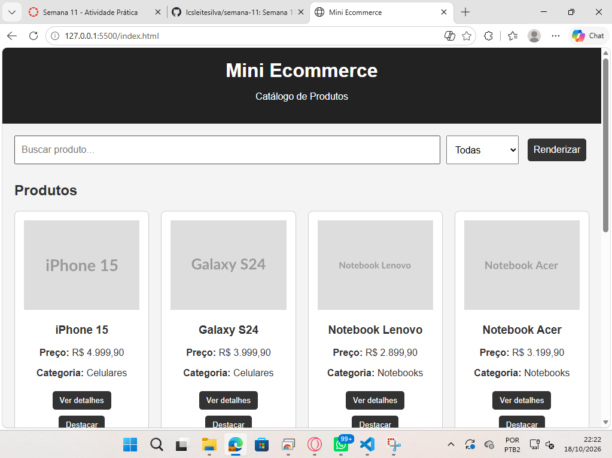
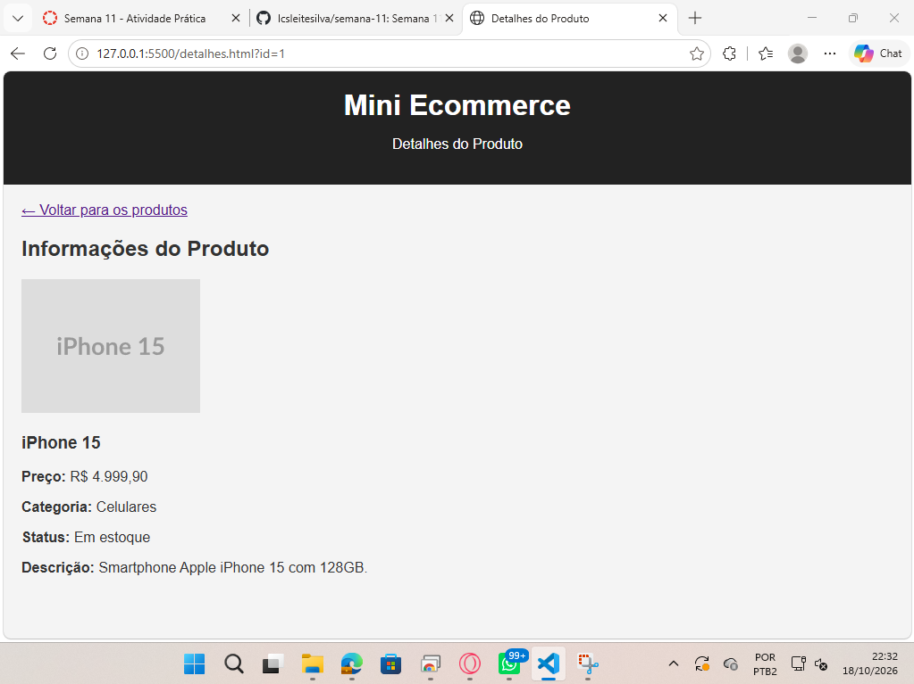
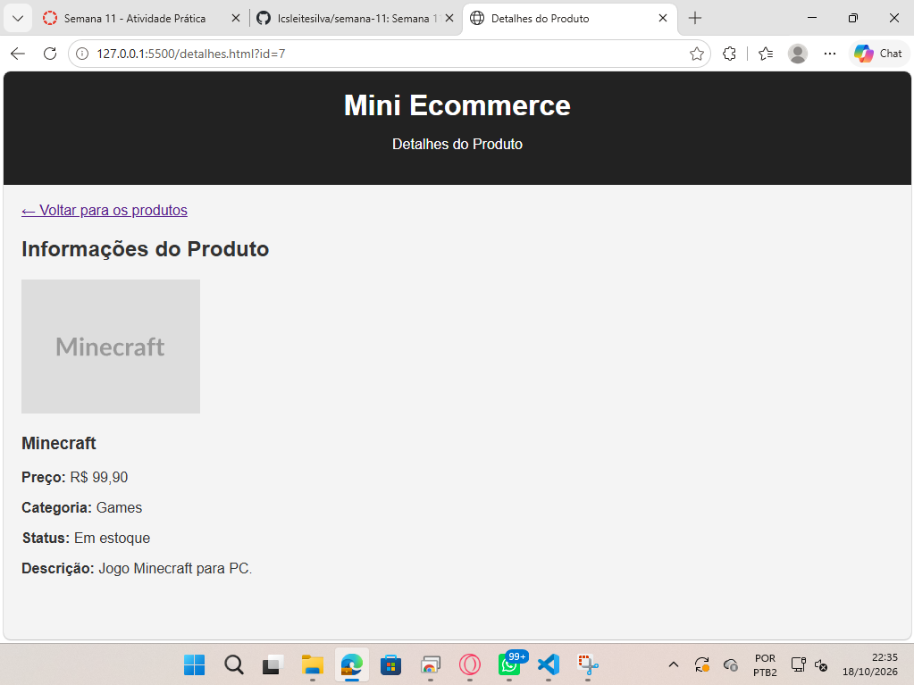

# Semana 11 - Atividade Prática: Páginas de Detalhes Dinâmicas

## Aluno

**Nome:** Lucas Leite Silva

**Matrícula:** 931215

## Sobre a atividade

Nesta atividade foi realizada a evolução do Mini Ecommerce desenvolvido na Semana 9, utilizando HTML, CSS e JavaScript.

O projeto apresenta um catálogo com 8 produtos, permitindo buscar pelo nome, filtrar por categoria e destacar os cards.

A principal novidade é a criação de uma página de detalhes dinâmica. Ao clicar no botão "Ver detalhes", o usuário é direcionado para outra página, que apresenta as informações completas do produto selecionado.

## Funcionalidades

- Listagem dinâmica de 8 produtos
- Busca de produtos pelo nome
- Filtro por categoria
- Botão para renderizar os produtos
- Botão para destacar os cards
- Navegação entre a página inicial e a página de detalhes
- Identificação do produto pelo ID enviado na URL
- Exibição dinâmica de imagem, nome, preço, categoria, estoque e descrição
- Botão para voltar ao catálogo de produtos

## Tecnologias utilizadas

- HTML5
- CSS3
- JavaScript
- Git e GitHub

## Estrutura do projeto

- `index.html` - Página inicial com o catálogo de produtos
- `detalhes.html` - Página dinâmica de detalhes
- `script.js` - Dados dos produtos e funcionalidades
- `styles.css` - Estilização das páginas
- `README.md` - Documentação do projeto

## Dados dos produtos

Os produtos estão armazenados em uma estrutura de dados JavaScript no formato de objetos, semelhante ao JSON.

Exemplo:

```json
{
  "id": 1,
  "nome": "iPhone 15",
  "preco": 4999.90,
  "categoria": "Celulares",
  "imagem": "https://placehold.co/200x150?text=iPhone+15",
  "descricao": "Smartphone Apple iPhone 15 com 128GB.",
  "emEstoque": true
}
```

## Funcionamento da página de detalhes

Ao clicar em "Ver detalhes", o JavaScript direciona o usuário para `detalhes.html`, passando o ID do produto pela URL.

Exemplo:

`detalhes.html?id=1`

A página utiliza `URLSearchParams` para obter o ID e o método `find()` para localizar o produto correspondente.

Assim, uma única página consegue apresentar dinamicamente as informações de todos os produtos.

## Prints da atividade

### Página inicial - Catálogo de produtos



### Página de detalhes - iPhone 15



### Página de detalhes - Minecraft


